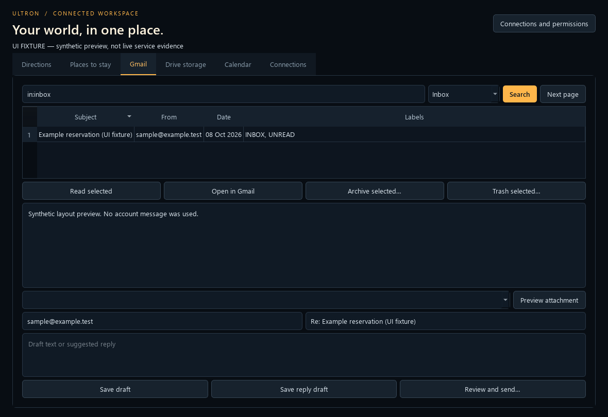

# Ultron Phase 2 — engineering report

**Delivered 9 October 2026 (Europe/Belgrade).** Upgraded the existing project in place. Gemini remains the primary brain, using **gemini-3.1-flash-live-preview** with the existing fallback, voice configuration and memory architecture.

**Verified:** 94 automated tests pass; 173 Python files parse; 18 built-in tools and 15 plugins load; all 33 discovered tool declarations validate. Real Gemini streaming and tool-to-panel routing, Gmail metadata, Chrome navigation, news and local research startup were checked.

**Still awaiting authorization:** Maps/Places/Embed, optional Amadeus, Drive, iCloud and Gmail write operations. Their live account operations are **UNVERIFIED**. No email was sent, item trashed, event created, accommodation booked or payment made during validation.

## 1. Existing features inspected

Reviewed the active Qt desktop, Gemini Live connection and recovery, audio streams, prompts, memory/configuration, dynamic plugin loading, Chrome/YouTube controls, Gmail, local research service, launchers and Phase 1 notes. Inventoried first-party sources, adapters and historical scripts; old patch scripts and alternate applications were not run as installers.

Phase 1's native amber orb, model/status display, source-aware research and news remain. Internal compatibility names such as CarLive, CarUI and ultron_mail_manager remain where renaming would break paths or interfaces. Active identity, UI branding, descriptions and notifications use Ultron.

Existing uncommitted work was preserved. No commit, push or deployment was performed.

## 2. Bugs found

- A 15-minute inactivity loop repeatedly requested unsolicited speech; morning briefings defaulted on.
- Mute did not consistently suppress background prompts, received PCM and buffered output.
- Settings writes could overwrite unrelated preferences.
- An old confirmation dialog could approve a replacement operation; long details were truncated.
- Chrome refocusing could blur the address bar, and URL observation depended on its localized label.
- Concurrent hardware probes could compete. Windows had also renamed the saved USB microphone by adding an instance prefix.
- Integrations lacked shared native panels, protected credentials and strict input validation.
- The installed CalDAV library lacks the initially assumed DAV privilege helper.
- Global google-antigravity has an incompatible protobuf requirement.
- Early OAuth/Gemini requests timed out; subsequent real requests succeeded.

## 3. Bugs fixed

**Silence:** removed the inactivity task and prompt, retained an inert compatibility shim, and explicitly disabled Gemini proactive audio. Startup briefings now default off while saved preferences remain. System-health speech needs separate opt-in. Mute gates background speech and output; interruption drains queued audio and aborts the output buffer. Direct interaction can start a fresh response. Existing requested alarms/reminders retain their individual behavior.

**Runtime:** shutdown stops live tasks/streams and initialized plugins without reconnecting. Cancellation during network backoff is tested. Audio enumeration is serialized before live streams open; tested endpoints are reused. USB instance prefixes match only when the normalized microphone name is unique. Ambiguous matches require a new selection.

**Approvals:** each review carries a unique operation token. Stale dialogs cannot approve a different operation. Long details use scrollable plain text. Gmail send/single-or-bulk trash, selected Drive trash and calendar writes require exact desktop review. Write grants are checked again before execution. No permanent Drive delete operation exists.

**Persistence/security:** configuration updates merge fields under a lock and replace files atomically. New integration credentials, subscription URLs and saved origin use Windows user-bound DPAPI. The existing Gmail token was migrated and its active plaintext copy removed. Gemini's existing configuration and recovery copies were preserved.

**Chrome:** preserve focused child controls, read the observed native address-bar class, expose revocable structured browser permission. No extension, debug port or replacement browser profile was installed.

**Remote features:** the existing phone dashboard and Telegram bridge no longer start by default; explicit environment opt-in is required. Neither was initialized in validation. Claude PC access, webcam gestures and the references' separate AI stacks were not initialized.

## 4. Plugin implementation and actual status

All 15 discovered plugins are currently enabled in saved configuration. Being enabled is separate from being authorized or live-verified.

| Plugin ID | Actual status | Evidence / remaining requirement |
| --- | --- | --- |
| google_maps | **Implemented but awaiting authorization** | Real Gemini call opened Directions. Mock routing/units/permissions tests pass. Actual route, geocode and Embed responses **UNVERIFIED** without keys. |
| accommodation_search | **Implemented but awaiting authorization** | Official Places discovery and optional production Amadeus offers; validation/source/price labels tested with fixtures. Live listings/photos/offers **UNVERIFIED**. No booking/payment tool. |
| ultron_mail_manager | **Read access working and live-tested; writes awaiting authorization** | OAuth refresh/profile and three inbox metadata records succeeded. Draft/label/archive/trash/send/preview paths implemented; consequential operations only mocked. Current grant is read-only. |
| google_drive | **Implemented but awaiting authorization** | Quota, pagination, metadata, duplicate candidates, charts and exact selected-trash review tested with mocks. No account token. |
| apple_calendar | **Implemented but awaiting authorization** | Windows iCloud CalDAV or read-only ICS; permissions, recurrence/DST, cancellation and stale-event tests pass. No account/subscription configured. |
| ultron_health | **Fully working and tested within its diagnostic scope** | Live local diagnostics report Ultron and dependencies without credentials. |
| world_briefing | **News retrieval working and live-tested** | 12 source-labelled headlines retrieved. Optional external monitor UI not retested. |
| omni_agent_acquire_clients | **Implemented; full workflow not live-tested** | Local research startup and health returned HTTP 200. No acquisition/outreach workflow submitted. On-demand startup retained. |
| antigravity_coder | **Partly blocked by external dependency; workflow UNVERIFIED** | Native agy help worked in Phase 1. Python google-antigravity 0.1.20 needs protobuf >=7.35; installed version is 5.29.6. No coding run. |
| chat_takeover | **Implemented but not live-tested** | Loads; no takeover or automatic messages activated. |
| document_review | **Implemented but not live-tested** | Loads; full document/camera workflow not exercised. |
| game_library_manager | **Implemented but not live-tested** | Loads without old name collision; no game install/update/purchase. |
| midea_cloud | **Implemented but not live-tested** | Dependency present; cloud login remains lazy; no appliance command. |
| movie_downloader | **Implemented but not live-tested** | Loads; no watchdog, download or Telegram notification started. |
| smartthings_control | **Implemented but not live-tested** | Loads; smart-home startup/exit effects suppressed during tests; no device command. |

New integrations have typed schemas, capability/authentication/permission metadata, panel routing and lifecycle support. Legacy plugins retain compatibility defaults, including 1.0-legacy where no version is supplied. Failure handling is isolated and error output redacted.

The 18 built-ins also load: browser, code helper, computer control/settings, desktop, development agent, file control/processing, flight finder, game updater, app opening, reminders, messaging, audio, video, weather, web search and YouTube. This validates discovery/schema compatibility, not every external workflow.

## 5. UI upgrades completed

Select **WORKSPACE** in Ultron. Six native Qt tabs share dark/amber styling:

- **Directions:** manual origin or explicit one-shot location permission, travel modes, sourced km/minutes, optional interactive Google map and external route button.
- **Places to stay:** city/dates/guests/budget/type/amenity/proximity preferences, property cards, source/price/fees/availability, optional photos, maps and directions.
- **Gmail:** filters/search/sorting/paging, message reading, draft/reply forms, attachment preview and reviewed send/archive/trash.
- **Drive storage:** shared-account quota vs Drive usage, largest files, MIME charts, checksum duplicate candidates, metadata, file/location links and selected cleanup.
- **Calendar:** native calendar, timezone, appointments, recurrence/reminder creation and reviewed changes.
- **Connections:** Google read/write consent, connection tests/disconnect, masked credential entry and browser/notification preferences.

Work runs off the Qt thread with duplicate-request prevention, slow-request notices and visible errors. Failed refreshes identify retained results as previous results. Late photo responses cannot target deleted cards. Small-window forms scroll.

Rendered all six panels at **1180×810 and 920×640**. Previews contain labelled synthetic fixtures, not real email, distance or price evidence. Windows fonts were explicitly loaded for offscreen rendering.

## 6. Security findings from the GitHub references

Retained Phase 1's pinned source audit and rechecked the saved hash manifest: **zero mismatches**. The duplicate Ultron link was audited once.

- Pinned upstream sources: see [THIRD_PARTY_NOTICES/README.md](../THIRD_PARTY_NOTICES/README.md).

No obvious RAT, credential-harvesting routine or unexpected persistence was found in the reviewed first-party sources/manifests. **This is a bounded source review, not a malware-free guarantee or an exhaustive dependency/binary audit.**

The Ultron lockfile audit found **6 affected packages: 1 critical, 4 high, 1 moderate**. Its Next.js/npm stack was not installed or run. Orb patterns were adapted to existing Qt/NumPy; the MIT notice remains in THIRD_PARTY_NOTICES/ultron-MIT.txt.

Friday's separate LiveKit/Sarvam/OpenAI stack and fabricated market commentary were excluded. Webcam/gesture model downloads were excluded. New panels were built directly in Ultron.

New embedded maps have no OAuth tokens/server key, local API bridge or granted camera/mic/location permission. The separate Embed-only browser key is deliberately public and must be API/referrer restricted. Provider text and reviews render as plain text; email HTML is not executed.

## 7. Automated tests and checks

Final suite: **94 tests passed in 2.820 seconds**, using Python unittest discovery in the tests directory.

Coverage includes prolonged inactivity, muted prompts/output, interrupt buffering, reconnect/backoff cancellation, plugin isolation/lifecycle, strict schemas, permissions, route fixtures/units/aliases/denials, lodging validation/honesty, real disposable DPAPI roundtrip, mocked OAuth refresh/scopes/disconnect, atomic settings, Gmail MIME/header safety/send and trash gates, Drive quota/pagination/checksums/selected cleanup, CalDAV privileges/recurrence/EXDATE/DST/exact review, stale confirmations/events, native Qt panels, Chrome focus/address regression, audio concurrency and USB identity.

The dashboard HTTP contract was tested in memory with ASGI; no listener or firewall setup was started. All provider mutations were mocked.

| Check | Result |
| --- | --- |
| Python syntax | 173 files parsed; no errors |
| Gemini declarations | 33 valid; 0 rejected plugins |
| Requirements dry run | Declared packages satisfied after installation |
| New dependencies installed | PyQt6-WebEngine 6.11.0, caldav 2.2.6, icalendar 7.3.0, recurring-ical-events 3.8.2 and dependencies |
| Installation method | Published registry wheels; no upstream GitHub install hooks |
| Global pip check | **Fails** on the pre-existing google-antigravity/protobuf constraint |
| Lint/type/build | No configured first-party pipeline found; Ruff/mypy/Flake8 absent. No claim those checks passed. Native Python app; no new npm build. |
| Upstream integrity | 0 saved-manifest mismatches |

A new settings test initially used the wrong argument shape; it was corrected to the existing keyword-only interface and rerun. No failing test was removed to obtain a pass.

## 8. Real integrations verified

| Check | Actual evidence |
| --- | --- |
| Gemini response | Existing model returned transcript containing “Ultron” and 81,150 audio bytes; test audio was not played aloud. |
| Desktop → Gemini → plugin → panel | Latest run connected in **3.52 s**. Gemini called google_maps/open_panel; Directions appeared; worker stopped cleanly with no harness errors. |
| Reconnection | Earlier run recovered after two opening-handshake timeouts; later runs connected normally. |
| Audio hardware | Real 16 kHz input read and 24 kHz output-silence write succeeded. Final startup resolved the saved Trust microphone despite its new Windows instance prefix. |
| Gmail | Refreshed existing read-only grant; profile and metadata for three inbox messages retrieved. |
| Chrome | Opened example.com and Google Maps Novi Sad → Vrbas URL; observed both addresses, closed only test tabs; count 8 before/after. Route distance was not verified. |
| News | 12 world headlines with sources/timestamps. |
| Research service | Existing local process started; health returned HTTP 200 with ultron-research; test-owned process stopped. No workflow submitted. |
| Health plugin | Ultron identity and required modules verified locally. |

Evidence lives in .audit: phase2-gemini-live.json, phase2-routing-live.json/log, phase2-startup.json, phase2-audio-live.json, phase2-live-checks.json, phase2-chrome-live.json, phase2-other-live.json, phase2-tests.log, phase2-validation.json and requirement/audit logs.

## 9. External blockers and unverified features

Missing Maps/Embed/Places keys prevent real routes, embedded maps and photos. Missing Amadeus production credentials prevent dated accommodation-offer checks. Missing Drive and iCloud authorization prevents live account tests. Gmail changes require a new write grant.

Precise device location was not requested. Audio devices opened and Gemini generated audio, but **physical audibility, spoken recognition/wake-word accuracy and room echo behavior remain UNVERIFIED**. Existing smart-home, chat takeover, autonomous coding, game/download and messaging workflows were not activated.

## 10. Exact manual actions required

1. Open the existing **Ultron** desktop shortcut or start_ultron.bat, then **WORKSPACE → Connections**. Isolated tests closed their own desktop instances.
2. **Gmail:** use **Test connection** to repeat the successful read-only check. For drafts/labels/archive/trash/send, select **Authorize changes** and complete Google consent in your browser. Sending still requires its exact review. No password needs to be sent in chat.
3. **Drive:** enable Google Drive API in the Cloud project owning your OAuth Desktop client. Use the existing client JSON or **Choose JSON**. Select **Drive → Connect read only**, complete consent, test, then **Drive storage → Analyze storage**. Trash needs **Authorize changes**. Read scope is drive.metadata.readonly; existing-file trash needs the broader drive grant.
4. **Maps:** enable billing, Routes API, Geocoding API and Places API (New) in your own Google Cloud project. Enter an API-restricted key in **Maps server key**. For the interactive map, enable Maps Embed API and use a separate Embed-only public browser key restricted to the application origin **https://ultron.local/** (HTTP-referrer restriction pattern https://ultron.local/*). Save settings. Actual origin/referrer behavior must be checked with your key; do not silently broaden restrictions if rejected. External Maps links do not need an Embed key.
5. **Origin:** enter a city/address in Directions, optionally save it. Precise location requires **Use device location**, one-shot approval and Windows Location permission. Use manual origin if unavailable.
6. **Accommodation:** Places discovery never confirms dated availability/price. Verify details on the property website. For actual hotel quotes, enter **production** Amadeus Self-Service credentials and select **Amadeus · production offers**. Sandbox offers are excluded. Complete any booking yourself through the external authorized site.
7. **iCloud on Windows:** enable Apple Account two-factor authentication and [generate an app-specific password](https://support.apple.com/en-us/102654). Enter account email and that app-specific password in Connections, save, then Calendar → Upcoming 7 days. Do not enter your main Apple Account password. Alternatively use an existing authorized iCloud webcal/HTTPS subscription for read-only access. Subscription mode takes precedence; **Disconnect iCloud** clears both modes before switching.
8. **Voice check:** select the intended microphone/speakers, unmute, ask “Who are you?” and verify audible “Ultron.” Mute and verify silence. No recording needs to be shared here.

References: [Google Desktop OAuth](https://developers.google.com/identity/protocols/oauth2/native-app), [Routes](https://developers.google.com/maps/documentation/routes/compute_route_directions), [Maps Embed](https://developers.google.com/maps/documentation/embed/embedding-map), [Places](https://developers.google.com/maps/documentation/places/web-service/text-search), [Drive quota](https://developers.google.com/workspace/drive/api/reference/rest/v3/about), [Drive listing](https://developers.google.com/workspace/drive/api/reference/rest/v3/files/list), [CalDAV compatibility](https://caldav.readthedocs.io/stable/about.html).

## 11. Remaining known issues and limits

- Network/provider reliability and quotas remain external; successful checks are point-in-time evidence.
- Recurring calendar changes require whole-series approval. Single-occurrence edits are refused. Conflict checks cover the displayed interval; later recurrence conflicts are explicitly unchecked. All-day events are displayed, but the create/edit form targets timed appointments.
- Drive scans up to 1,000 files and limits work between pages by response time; partial scans are labelled. Shared account usage is distinguished from Drive. Checksum matches are review candidates, never automatic deletion.
- Maps Embed is a provider view, not a custom map plotting every exact offer ID. Exact property directions depend on available address/coordinates.
- Property type, amenities, proximity and budget are preferences when providers cannot certify them. Only returned same-currency Amadeus totals are numerically budget-filtered; extra fees remain provider-dependent.
- Attachment previews support plain text and small PNG/JPEG images. PDF/larger/unsupported files use Gmail's viewer.
- Chrome permission controls structured browser/YouTube handlers; it is not an OS security boundary against every legacy desktop-control tool.
- Legacy plugins retain compatible metadata/lifecycle defaults; not every old workflow has a new Workspace panel.
- The disabled-by-default phone dashboard's historical LAN/firewall/loopback trust model was not redesigned or certified for exposure. This upgrade is not remote-access hardening.
- pynvml deprecation, Windows COM and Google SDK schema warnings are non-fatal. Global protobuf conflict remains to avoid disrupting Gemini.
- New integration credentials are encrypted; existing Gemini configuration and private recovery snapshots still contain sensitive settings. Keep backups local.
- Repository findings apply only to pinned source commits, not future releases or all binaries/dependencies.

## 12. Recommended next improvements and recovery

After account setup, execute real read-only Maps/Places/Drive/Calendar scenarios. Use disposable user-selected email/file/event fixtures for explicitly approved live write tests. Validate physical speech/wake accuracy and actual Embed restrictions.

Future engineering priorities: isolate optional Antigravity dependencies, support individual recurrence edits, add authorized account end-to-end fixtures and migrate remaining legacy metadata/UI. These are recommendations, not completed features.

Recovery snapshot: **backups/ULTRON_BEFORE_PHASE2_20261008**. Phase 1 recovery/report remain. Sensitive snapshots, credentials and audit files are Git-ignored. Launch with **start_ultron.bat**; startup log is **logs/main.log**.
